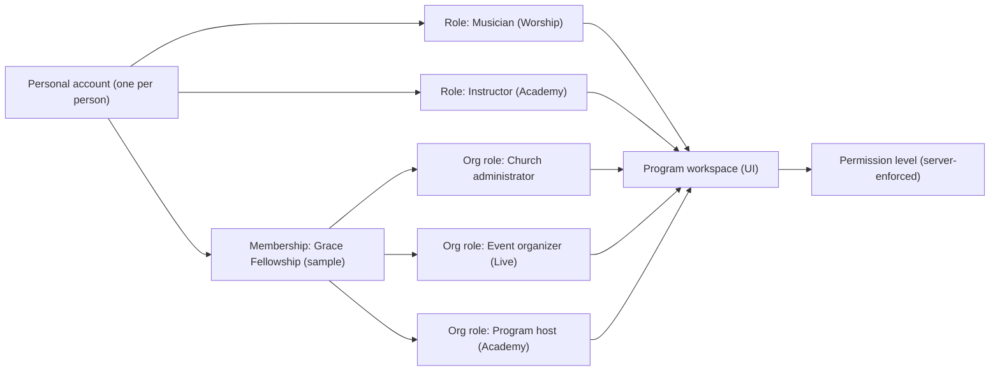

# Authenticated Dashboard Architecture & UX Guidelines

> **Status (2026-10-19):** the previous admin app (`apps/admin`: pages, `/api/*` staff routes, `scripts/admin/*`, `staff:account:sql`, `make *-admin`) was deleted and a new admin is being designed from scratch. What this describes about it is historical. Still in the repo: the shared backend (`@gamo/auth` staff and admin-password code, `AdminService`, `ParticipationService`, the review handlers in `@gamo/domain`), the `admin` entries in `@gamo/config`, the `adminCredentials` table (migration 0005) and the admin Cloudflare resources.

<!-- status-banner: 2026-10 foundation pass -->
> **Partly stale.** Dashboard UX guidance still applies; access rules are now enforced by `packages/auth/page-access.ts` and tested in `scripts/audit/private-routes.test.ts`. Current reference: [ARCHITECTURE.md](ARCHITECTURE.md).

Updated 2026-10-13 following the comprehensive UX audit and refinement pass. This document describes the **UI system** for signed-in experiences across Gamo Studios, the **reusable UX and responsive design patterns**, and the **intended future authorization boundaries**.

> [!NOTE]
> Every dashboard route operates in **design-first preview mode**: there is no live authentication, session store, or server-side permission check. A conspicuous demo banner is visible at all times, and experiences are presented through a fixed, fictional persona (**Jordan Avery**).

---

## 1. Shared System (`packages/ui`)

| Layer | Files | Purpose |
| --- | --- | --- |
| **Model** | `src/lib/dashboard.ts` | `Workspace`, `DashScreen` (with `aliases` support), typed `DashBlock` union, `DEMO_PERSONA`, `workspaceDirectory()` registry, `findScreen()` with alias resolution. |
| **Behaviour** | `src/lib/dashboard-client.ts` | Local-only menus, dialogs, form validation with assistive technology announcements, table filtering, calendar selection, switch toggles. No network calls. |
| **Shell** | `components/dashboard/DashboardShell.astro`, `DashNav`, `WorkspaceSwitcher`, `AccountMenu`, `DemoModeBanner` | Desktop sidebar (256px), mobile offcanvas drawer (`#dash-drawer` with persona header and sign-out links), mobile bottom tab bar, top bar (search, alerts, workspace switcher, account menu). |
| **Screen** | `WorkspaceScreen.astro`, `DashPageHeader.astro`, `StateView.astro` | Semantic breadcrumb navigation (`<nav aria-label="Breadcrumb">`), restrained titles (26–30px), contextual actions, `?state=loading\|empty\|error\|success` design-review preview switcher, not-found fallback. |
| **Blocks** | `DashBlocks.astro` | Composed responsive blocks: `StatGrid`, `DataTable` (desktop `<table>` ≥ md, stacked cards on mobile with client search & chips), `ItemList` (with overflow-safe titles), `Agenda`, `MonthCalendar` (contrast-safe selected dots), `StepList`, `KeyValueList`, `InlineNotice`, `QuickActions`, `DashForm`/`FormFields` (with `aria-describedby` error linking), `SettingsPanel`, `ProgressList`, `CardGrid`, `Statement` (musician/instructor pay strictly separated from administrative allocations), `DashDialog` (viewport-constrained native `<dialog>`), `Panel`, `CellValue`. |
| **Account entry** | `AuthLayout.astro`, `AuthPage.astro`, `OnboardingSteps.astro` | Focused sign-in, sign-up, recovery, and multi-step onboarding wizard with demo validation. |

### Typography Scale & Proportions
- **Dashboard page heading (`h1`):** 26–30px (`text-[26px] sm:text-[30px] font-semibold tracking-[-0.02em]`).
- **Section / panel heading (`h2`):** 17–19px (`text-[17px] sm:text-[19px] font-semibold tracking-[-0.01em]`).
- **Card title (`h3`):** 15–16px (`text-[15px] font-semibold`).
- **Body text:** 14–15px (`text-[14px] sm:text-[15px] text-charcoal/85 leading-6`).
- **Supporting / metadata label:** 11–13px (`text-[12px] text-ink-soft`).

Dashboards are more functional, compact, and restrained than public marketing pages. Large empty hero sections and oversized marketing imagery are forbidden inside signed-in workspaces.

---

## 2. Identity Model — One Account, Many Roles

| Concept | Meaning | Example |
| --- | --- | --- |
| **Personal account** | The human. One login, one profile, one notification inbox. | Jordan Avery (fictional) |
| **Active role** | Capacity the person is acting in right now. | Musician, Instructor, Attendee, Technician |
| **Active organization** | Church/organization context for org-scoped roles (optional for personal roles). | Grace Fellowship (sample) |
| **Program workspace** | The UI surface for a role in a program. | `/musician`, `/church`, `/organizer`, `/family`, `/host` |
| **Permission level** | What the role may do inside that organization/workspace. | Admin, Scheduler, Viewer; staff Reviewer, Operations lead |

The demo switcher lists every workspace in `workspaceDirectory()`. It changes only the page being viewed — never identity or permissions — and can never select a real user.

---

## 3. Reusable UX & Responsive Patterns

### 3.1 Offcanvas Mobile Drawer (`#dash-drawer`)
- **Docking:** Explicitly styled with `fixed inset-y-0 left-0 h-full max-h-none m-0 z-50` to guarantee reliable left docking across iOS Safari, WebKit, and Chromium.
- **Identity Context:** Features a prominent persona header with avatar initials (`JA`), full name (`Jordan Avery`), active role, and active organization so mobile users always understand their current persona.
- **Independent Scroll:** Nav links are wrapped in `overflow-y-auto flex-1` so long nav structures scroll cleanly without page stutter.
- **Direct Shortcuts:** Bottom drawer footer provides instant touch access to Profile (`/account/profile`), Alerts (`/account/notifications`), and Exit Demo (`/account/signed-out`).

### 3.2 Viewport-Constrained Native Dialogs (`DashDialog.astro`)
- Modal `<dialog>` elements use `max-h-[min(90vh,42rem)] overflow-y-auto` to prevent action buttons from being pushed below the mobile viewport.
- Dialog headers use `sticky top-0 z-10 backdrop-blur` to keep titles and close buttons visible while scrolling long forms.
- Full keyboard focus trapping and Escape key dismissal are handled natively and augmented by `dashboard-client.ts`.

### 3.3 Semantic Breadcrumb Navigation (`DashPageHeader.astro`)
- Workspaces render `<nav aria-label="Breadcrumb">` above the page `h1`.
- Ancestor workspace links allow 1-click return to the workspace root (`workspace.basePath`).
- Active screens are denoted with `aria-current="page"`.

### 3.4 Dynamic Route Aliasing (`findScreen`)
- `DashScreen` declares optional `aliases?: string[]` to support singular/plural routes (e.g. `/family/instructor` and `/family/instructors`) and legacy aliases (e.g. `/church/musicians` and `/church/roster`, `/musician/gig` and `/musician/service`).
- `findScreen` matches both canonical `slug` and any alias, eliminating 404 dead ends.

### 3.5 Overflow Protection in Dense Layouts
- All item list, card, and panel headings apply `break-words [overflow-wrap:anywhere]` to ensure long unbroken technical strings (e.g. file names or URLs) do not cause horizontal scrolling on narrow 1024px/1280px viewports.

---

## 4. Accessibility Standards (WCAG 2.1 AA)

1. **Form Error Announcement:** All inputs reference error messages via `aria-describedby={`${id}-error`}` and hints via `${id}-hint`. When client validation flags `aria-invalid="true"`, screen readers immediately announce the specific error message upon focus.
2. **Contrast on Selected Elements:** Calendar day buttons invert dark event dots (`bg-charcoal` → `bg-cream`) when selected (`aria-pressed="true"`), maintaining a minimum 4.5:1 contrast ratio.
3. **Visible Focus Rings:** All interactive elements (`a`, `button`, `summary`, `[role="switch"]`, `.chip`, `input`, `select`, `textarea`) receive explicit 2px terracotta focus outlines (`#b65b35`) with 2–3px offset on light surfaces and cream outlines (`#f4ede3`) on dark surfaces.
4. **Touch Target Sizing:** Navigation items, drawer buttons, filter chips, and dialog actions provide minimum 40–44px hit targets.
5. **No Color-Alone Status Communication:** Every badge or status pill renders explicit text alongside color cues (`Covered`, `Unmatched`, `Scheduled`, `In review`).

---

## 5. Role-Specific Design Principles

- **Worship Musician:** Avoid corporate gig economy terminology. Use "Service details", "Assignments", and "Worship placement". Keep musician compensation separate from administrative allocations.
- **Worship Church Admin:** Provide immediate Sunday coverage visibility ("4 of 6 services covered with standby"). Allow 2-step requests with clear style, arrival time, and rehearsal details.
- **Academy Student / Family:** Warm, encouraging, parent-first tone. Protect minor learners' privacy: never expose home addresses or contact info. Focus on lesson times, practice encouragement, and milestones.
- **Academy Instructor:** Operational teaching tool: class schedules, student rosters showing only first name + last initial and attendance, lesson plan builder, and clean attendance checklists.
- **Live Event Organizer:** Focus on event readiness, admission counts, door scanning preparation, and transparent proposed payout statements.
- **Live Event Attendee:** Clear ticket view prominently marked "Not valid for admission" to prevent misuse, straightforward free RSVP management, and calendar export prompts.
- **Production Client & Crew:** Technical clarity, signal flow notes, acoustic needs assessments, milestone tracking, and safety-first training prioritization.
- **Staff Command Center:** Exception-driven triage: pending audition reviews, unmatched church requests, safeguarding screening status, and ethical fairness reminders.

---

## 6. Future Authorization Boundaries (Server-Enforced)

| Workspace | Required Grant (future) | Data Boundary |
| --- | --- | --- |
| **Personal account** `/account` | Authenticated session | Own profile, own memberships, own notifications |
| **Musician** `/musician` | Approved musician role | Own assignments, availability, statements. Never other musicians' pay or identity documents. |
| **Church** `/church` | Membership with Admin/Scheduler on that church | That church's requests, services, assigned musicians (approval status only, never identity documents) |
| **Family** `/family` | Guardian of learner(s) or adult learner | Own household learners only |
| **Instructor** `/instructor` | Screened, approved instructor | Assigned classes; roster shows first name + initial, level, attendance; contact via program office |
| **Host** `/host` | Org membership with host permission | Aggregate enrollment counts only; no minors' individual records |
| **Organizer** `/organizer` | Org role + verification for publishing; separate ticketing authorization | Own events; attendee data minimized; payouts only after approved policies |
| **Attendee** `/me` | Authenticated session | Own tickets/registrations |
| **Production client** `/client` | Org membership | That church's projects, documents and messages |
| **Crew** `/crew` | Approved volunteer/technician | Assigned projects and tasks |
| **Partner** `/partner` | Partner contact for the organization | That organization's commitments, records and reports |
| **Admin** (`apps/admin`) | Staff identity + Cloudflare Access + per-area staff role; audit logged | Least privilege per area (Worship review, Academy safeguarding, Live moderation, Finance). Sensitive evidence stays in specialized providers. |

---

## 7. Consolidation & Legacy Routing

- Gamo Live organizer: former `/organizer`, `/organizer/dashboard`, `/organizer/manage`, `/organizer/report`, `/organizer/verification`, `/organizer/promotion` consolidated into `/organizer/*`.
- Academy `/dashboard` redirects (301) to `/family`.
- Live `/my-tickets` redirects (301) to `/me/tickets`.
- Worship `/church/roster` resolves via alias to `/church/musicians`.
- Worship Musician `/musician/gig` resolves with aliases `service` and `assignment`.
- Worship admin staff prototypes redirect (301) to `apps/admin`.
- Academy Family `/family/instructor` and `/family/instructors` both resolve cleanly via route aliasing.
