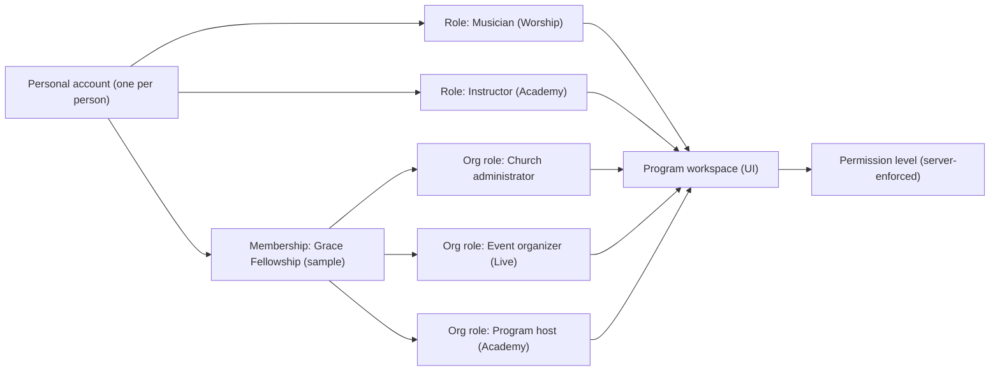

# Authenticated Dashboard Architecture (design-first phase)

Updated 2026-10-13. This document describes the **UI system** for signed-in experiences across Gamo Studios and the **intended future authorization boundaries**. Nothing described here is enforced yet: there is no authentication, session, role store or server-side permission check. Every dashboard route is a public, `noindex` demo surface with a conspicuous demo banner and a fixed fictional persona (Jordan Avery).

## 1. Shared system (`packages/ui`)

| Layer | Files | Purpose |
| --- | --- | --- |
| Model | `src/lib/dashboard.ts` | `Workspace`, `DashScreen`, typed `DashBlock` union, `DEMO_PERSONA`, `workspaceDirectory()` (demo switcher registry), helpers |
| Behaviour | `src/lib/dashboard-client.ts` | Local-only menus, dialogs, form validation, table filtering, calendar selection, switches. No network calls. |
| Shell | `components/dashboard/DashboardShell.astro`, `DashNav`, `WorkspaceSwitcher`, `AccountMenu`, `DemoModeBanner` | Desktop sidebar, top bar (search, notifications, switcher, account menu), mobile drawer + bottom tabs |
| Screen | `WorkspaceScreen.astro`, `DashPageHeader.astro`, `StateView.astro` | Header with restrained type, actions, `?state=loading|empty|error|success` previews, not-found |
| Blocks | `DashBlocks.astro` → `StatGrid`, `DataTable` (table ≥ md, stacked cards on mobile), `ItemList`, `Agenda`, `MonthCalendar`, `StepList`, `KeyValueList`, `InlineNotice`, `QuickActions`, `DashForm`/`FormFields`, `SettingsPanel`, `ProgressList`, `CardGrid`, `Statement`, `DashDialog`, `Panel`, `CellValue` | Reusable, typed, container-query responsive |
| Account entry | `AuthLayout.astro` | Focused sign-in/sign-up/recovery layout with demo banner |

Typography: page titles 26–30px, section/panel headings 16–17px (cards 15px), body 14px, labels 11–13px. Inter, ivory/cream surfaces, charcoal sidebar, terracotta accents, `border-sand` hairlines and minimal shadows. No marketing heroes or photography inside workspaces.

Each app declares its workspaces in `src/data/workspaces/*.ts` and renders them through one dynamic route (e.g. `src/pages/musician/[...slug].astro`). Page files stay tiny (component-first rule).

## 2. Identity model — one account, many roles

| Concept | Meaning | Example |
| --- | --- | --- |
| Personal account | The human. One login, one profile, one notification inbox. | Jordan Avery (fictional) |
| Active role | Capacity the person is acting in right now. | Musician, Instructor, Attendee |
| Active organization | Church/organization context for org-scoped roles (optional for personal roles). | Grace Fellowship (sample) |
| Program workspace | The UI surface for a role in a program. | `/musician`, `/church`, `/organizer`, `/host` |
| Permission level | What the role may do inside that organization/workspace. | Admin, Scheduler, Viewer; staff Reviewer, Operations lead |

The demo switcher lists every workspace in `workspaceDirectory()`. It changes only the page being viewed — never identity or permissions — and can never select a real user.

## 3. Future authorization boundaries (to be enforced server-side)

| Workspace | Required grant (future) | Data boundary |
| --- | --- | --- |
| Personal account `/account` | Authenticated session | Own profile, own memberships, own notifications |
| Musician `/musician` | Approved musician role | Own assignments, availability, statements. Never other musicians' pay or identity. |
| Church `/church` | Membership with Admin/Scheduler/Viewer on that church | That church's requests, services, assigned musicians (approval status only, never identity documents) |
| Family `/family` | Guardian of the learner(s) or adult learner | Own household learners only |
| Instructor `/instructor` | Screened, approved instructor | Assigned classes; roster shows first name + initial, level, attendance; guardian contact via program office |
| Host `/host` | Org membership with host permission | Aggregate enrollment counts only; no minors' individual records |
| Organizer `/organizer` | Organizer role for the organization + verification for publishing; separate ticketing authorization | Own events; attendee data minimized; payouts only after approved policies |
| Attendee `/me` | Authenticated session | Own tickets/registrations |
| Production client `/client` | Org membership | That church's projects, documents and messages |
| Crew `/crew` | Approved volunteer/technician | Assigned projects and tasks |
| Partner `/partner` | Partner contact for the organization | That organization's commitments, records and reports |
| Admin (`apps/admin`) | Staff identity + Cloudflare Access (additional gate) + per-area staff role; audit logged | Least privilege per area (Worship review, Academy safeguarding, Live moderation, Finance). Safeguarding and identity results stay in specialized providers, never in general screens. |

Rules: the frontend is never the authority; every read/write is checked server-side against (account, organization, role, permission); org switching re-scopes server queries; staff actions are audit logged; sensitive evidence (IDs, background checks, payment details) is never rendered in general dashboards.

## 4. Consolidation decisions

- Gamo Live organizer: the former `/organizer`, `/organizer/dashboard`, `/organizer/manage`, `/organizer/report`, `/organizer/verification`, `/organizer/promotion` pages were merged into one workspace at `/organizer/*`; legacy paths redirect.
- Academy `/dashboard` redirects to the improved family workspace `/family`.
- Live `/my-tickets` redirects to `/me/tickets`.
- Worship `/church/roster` redirects to `/church/musicians`; the old Worship `/admin` staff prototypes redirect to the staff app (`apps/admin`, port 4326).
- The public `/signin` sample entry is preserved; the full account entry lives at `/account/signin`.
