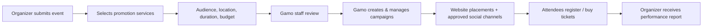

# Gamo Live, Church Partners & the Dynamic Homepage — Product Strategy

**Status:** approved strategic direction (2026-10-12). All prices, fees, discounts, tiers and percentages below are **proposals** until the owner explicitly approves them. Nothing here authorizes implementation; see [ROADMAP.md](../ROADMAP.md) for phase gates.

Related: [README.md](../README.md) · [ARCHITECTURE.md](../ARCHITECTURE.md) · [DESIGN.md](../DESIGN.md) · [SCREEN_INVENTORY.md](SCREEN_INVENTORY.md) · [FUNCTIONALITY_PHASE_PLAN.md](FUNCTIONALITY_PHASE_PLAN.md)

---

## 1. Positioning

The Gamo Studios homepage is a **continuously refreshed showcase of what is happening across the Gamo ecosystem**, not a static brochure. Three connected business opportunities drive it:

1. **Event discovery and ticketing** (Gamo Live).
2. **Church advertising and memberships** (Gamo Church Partners).
3. **Cross-promotion of Gamo services** (Worship, Academy, Live, Production).

**Gamo Live is a two-sided platform:** organizers promote events and manage ticketing; audiences discover and attend events. It integrates with the wider marketplace, church memberships and marketing services.

"**Keep Worship Going**" remains the permanent brand message; the hero becomes an editorially curated spotlight around it.

## 2. Gamo Live — two audiences

### A. Event organizers — *Promote Events*
Eligible organizers: churches, gospel artists, choirs, concert promoters, other approved community organizers.

Gamo Studios provides:
- Event publication and discovery on Gamo websites.
- Featured event advertising on Gamo pages, including the dynamic global homepage.
- Social media advertising campaigns managed by Gamo **on behalf of** organizers.
- Event marketing support, promotional creative and campaign management.
- Ticket sales and registration infrastructure for paid and free events.
- Performance reporting: views, clicks, registrations, ticket sales and available advertising analytics.

Eligible event types: concerts, worship nights, choir tours, conferences, Bible studies, church gatherings and other relevant community events.

### B. Attendees — *Explore Events*
- Discover events by location, date, organizer and event type.
- Explore events hosted by favorite churches, choirs and gospel artists.
- Discover free and ticketed events.
- Purchase tickets securely for paid events; register for free events that require it.
- Access tickets, confirmations and event details.
- *Later:* follow organizers and receive relevant event notifications (opt-in only).

## 3. Homepage Gamo Live section — audience pill

The section uses a pill-style selector (implemented as an accessible tablist) with two entry points:

| | **Promote Event** (default) | **Explore Events** |
|---|---|---|
| Audience | Churches & organizers | Event-goers |
| Message | We advertise your event on social media and Gamo sites and handle ticketing. | Find concerts, worship nights and choir tours near you; get tickets quickly. |
| Primary CTA | Promote an Event → `live.gamostudios.com/promote` (screen planned) | Explore Events → `live.gamostudios.com/` |
| Journey | Promote landing → submit event → choose promotion services → review → campaign live → reports | Discover → event detail → register / checkout → ticket |

Heading: "Promote Your Events. *Bring People Together.*" The Cinematic Editorial Interface is preserved; the pill must not turn the section into a generic SaaS layout.

## 4. Managed advertising workflow

Advertising starts as a **managed service**: Gamo staff review and run every campaign.

- No third-party advertising API (Meta, Google, TikTok, etc.) is assumed connected or authorized. Social campaigns are run manually by staff until an integration is separately approved.
- Later phases may add automated campaign creation, budget pacing and analytics integrations — each requires its own approval.
- Staff may reject or request changes to events/creative that violate content policy.

## 5. Revenue model (all figures proposed, none finalized)

| Stream | Components |
|---|---|
| **Event promotion** | Fixed campaign management fees; advertising packages by scope/duration; optional creative production & event marketing; **media budgets paid separately** from Gamo's management fees. |
| **Ticketing** | Transparent platform fee on paid ticket transactions; Stripe Connect marketplace payout architecture (subject to provider requirements); free listings/registrations under defined platform policy. |
| **Gamo Church Partners** | Recurring paid church membership; advertising credits or discounted promotion packages; preferential pricing across Worship, Academy, Live and Production. |

### Money separation (must be preserved in ledger design)
1. **Advertising/media spend** — organizer money committed to paid media; tracked per campaign; not Gamo revenue.
2. **Gamo service fees** — campaign management, creative, membership, platform fees; Gamo revenue.
3. **Ticket-sale proceeds** — belong to the organizer less disclosed fees; paid out via Stripe Connect.

Stripe does **not** provide general-purpose escrow; never describe held funds as escrow. Funds-flow pattern (destination charges, separate charges & transfers, etc.) is chosen at implementation after provider research.

## 6. Gamo Church Partners membership

A paid membership for churches that regularly use the platform. **Ordinary event listings remain available without membership**; membership unlocks exposure and benefits.

| Benefit | Proposed offering |
|---|---|
| Event listings | Publish free and ticketed events |
| Advertising | Featured promotional slots across Gamo Studios |
| Social media | Promotional support for selected events |
| Musician bookings | Discounts on Gamo platform fees |
| Gamo Academy | Member pricing for group clinics |
| Gamo Production | Discounts on eligible A/V services |
| Analytics | Event views, clicks, ticket sales, audience engagement |

### Integrity rules (non-negotiable)
- Paid placements are **visibly labeled "Sponsored"**; editorial recommendations are labeled separately.
- Advertising spend or membership **never** influences musician vetting, reliability rankings, professional scores or trust indicators.
- Booking discounts come **from Gamo's fees**, never from musicians' agreed pay.

## 7. Dynamic homepage hero — content rules

- Rotating spotlight of: featured events, church/organizer campaigns, Worship, Academy lessons, Live discovery, Production, Church Partners benefits.
- The approved hero composition is preserved; slides swap content within it.
- **Motion:** auto-advance ~8–10 s; manual prev/next and slide indicators; pause on hover, focus and interaction; no auto-rotation under `prefers-reduced-motion`; pause control available.
- **Not hardcoded:** slides eventually come from a promotion engine weighing event date, campaign window/expiry, location relevance, editorial priority, active campaigns and membership benefits.
- **Geographic relevance:** e.g. Phoenix visitors see nearby events; others see national tours or Gamo services. Location is approximate, opt-outable, and never required.
- **Balance:** editorial rules cap sponsored density so promotions never overwhelm the visitor experience (cap value TBD).
- Each slide carries a label: *Sponsored*, *Featured* (editorial) or *Gamo Service*; design-phase slides are labeled *Example*.

## 8. Application responsibilities

| App | Future functionality |
|---|---|
| `gamostudios.com` | Dynamic homepage promotions; cross-app promotion; Church Partners discovery & onboarding |
| `live.gamostudios.com` | Organizer event submission; publishing & discovery; free registration & paid ticketing; promotion package selection; ticket management; campaign reporting |
| `admin.gamostudios.com` | Event moderation; campaign intake & management; featured-placement scheduling; ad budget & campaign status tracking; ticketing oversight; organizer & membership management |
| `production.gamostudios.com` | Optional promotional creative, event marketing and production services |
| `worship` / `academy` | Apply Partner discounts to Gamo fees; surface Partner status |

Stack is unchanged: Astro, Cloudflare (Workers/D1/R2/DO/Queues), Stripe Connect, Resend. No new providers without justification and approval.

## 9. Unresolved business decisions (owner input required)

1. Partner tiers: one tier or several? Monthly vs annual billing? Prices?
2. What advertising credits each tier includes, and whether unused credits roll over.
3. Discount levels for musician bookings, Academy clinics and Production services.
4. Campaign management fee structure and package definitions.
5. Ticketing platform fee: percentage, fixed, or both; who pays (buyer vs organizer)?
6. Free event policy: always free? Limits on free registrations?
7. Organizer eligibility & content policy (non-church organizers, secular venues, political/fundraising events).
8. Approved social channels and who owns ad accounts; how media spend is invoiced and reconciled.
9. Refund/cancellation policy for tickets and for unspent media budgets.
10. Sponsored density cap on homepage and placement pricing model (flat slot, CPM, credits).
11. Payout timing for organizers and Stripe Connect account type.
12. Geographic launch scope beyond Phoenix for events and advertising.
13. Whether non-church organizers can join a partner/membership program.
