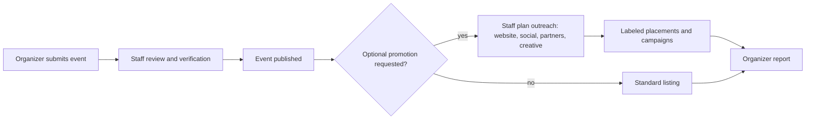

# Gamo Live, Church Partnerships & the Dynamic Homepage

**Status:** Revised 2026-10-12 for the nonprofit direction. Organizational purpose, funding and fee philosophy are governed by [GAMO_NONPROFIT_MODEL.md](GAMO_NONPROFIT_MODEL.md); this document holds the **detailed product rules** for Gamo Live, church partnerships and the dynamic homepage. All fees, contributions, tiers and percentages are **unapproved proposals**. Nothing here authorizes implementation; see [ROADMAP.md](../ROADMAP.md) for phase gates.

Related: [README.md](../README.md) · [ARCHITECTURE.md](../ARCHITECTURE.md) · [DESIGN.md](../DESIGN.md) · [SCREEN_INVENTORY.md](SCREEN_INVENTORY.md) · [FUNCTIONALITY_PHASE_PLAN.md](FUNCTIONALITY_PHASE_PLAN.md)

> [!NOTE]
> **Superseded (2026-10-12):** the earlier version of this document framed Gamo Live advertising, ticketing platform fees and a paid Church Partners advertising/discount membership as "three business opportunities" and revenue streams. That commercial framing is withdrawn. Useful product mechanics (two audiences, labeled placements, money separation, dynamic hero rules) are retained below.

---

## 1. Positioning

The Gamo Studios homepage is a **continuously refreshed window into what is happening across the Gamo Studios mission**: worship coverage, music education, Christian events, production support and church partnerships. "**Keep Worship Going**" remains the permanent brand message.

**Gamo Live** is a distinct program: a trusted home for discovering, attending, organizing and supporting **Christian events nationwide**. Eligibility is based on Christian purpose, not ethnicity or nationality.

## 2. Gamo Live — two audiences

### A. Organizers — *Promote Event*

Eligible organizers: churches, ministries, Christian artists, choirs and other **authorized** Christian event organizers. Organizer identity and authority to list (and, where relevant, to sell tickets for) an event are verified before the organizer is labeled **Verified**.

Gamo Live provides (planned):
- Event submission, staff review and publishing; one-time and recurring schedules.
- Free event discovery and optional free registration.
- Paid ticketing **only** where Gamo has documented organizer authorization; official ticket distribution; QR admission where needed.
- Event updates, cancellations and organizer communication.
- Attendance, registration and ticket reports.
- *Optional* awareness support: featured placement, social media, community outreach, creative production and partner communications (see §4).

Eligible event types: gospel concerts, Christian artist tours, worship nights, choir festivals, church conferences, prayer gatherings, Bible studies, Christian youth events, retreats, church community events, sponsored music workshops, free educational gatherings, recurring religious activities and other eligible Christian events.

### B. Attendees — *Explore Events*

- Discover events by location, date, organizer, event type and free/paid.
- See whether an organizer is verified.
- Register for free events; purchase tickets for authorized paid events with prices, fees, refund policy and organizer details shown up front.
- Access tickets, confirmations and event details.
- *Later:* follow organizers and receive opt-in notifications.

## 3. Homepage Gamo Live section — audience pill

Accessible tablist with two entry points:

| | **Promote Event** (default) | **Explore Events** |
|---|---|---|
| Audience | Churches, ministries, artists, organizers | Individuals, families, communities |
| Message | Share your Christian event with the community, with optional registration and ticketing. | Find worship nights, concerts, conferences, Bible studies and free gatherings. |
| Primary CTA | Promote an Event → `live.gamostudio.org/promote` (screen planned) | Explore Events → `live.gamostudio.org/` |
| Journey | Promote landing → submit event → organizer verification → staff review → published → reports | Discover → event detail → register / checkout → ticket |

The Cinematic Editorial Interface is preserved; the pill must not turn the section into a generic SaaS layout.

## 4. Event promotion service (optional, managed)

Promotion is a **service to increase awareness and participation**, not the central purpose of Gamo Live.

- Staff manage any campaign manually. No advertising-platform API (Meta, Google, TikTok, etc.) is assumed connected; any integration requires separate approval.
- Paid or sponsored placements are **always labeled "Sponsored"** and visually distinct from editorial ("Featured") picks.
- Staff may reject events or creative that fall outside the Christian event scope or content policy.

## 5. Financial treatment (proposed — none approved)

See [GAMO_NONPROFIT_MODEL.md §5](GAMO_NONPROFIT_MODEL.md#5-organizational-sustainability).

| Activity | Proposed approach |
|---|---|
| **Free events / registration** | Free to list and register by default intent; final free-event policy pending approval. Minimize barriers for religious and educational gatherings. |
| **Paid ticketing** | A reasonable, disclosed ticketing or registration administration fee may cover payment processing, operations and support. Amount, payer and refund policy pending approval. |
| **Optional promotion services** | Cost recovery for staff time and creative; organizer-funded media budgets tracked separately and never treated as Gamo income. Tax treatment pending review. |

### Money separation (must be preserved in ledger design)
1. **Third-party payables** — ticket proceeds owed to organizers, organizer-funded media budgets. Not Gamo income.
2. **Program-service receipts** — disclosed administration fees and promotion cost recovery.
3. **Contributions and sponsorships** — tracked separately from fees (restricted/unrestricted).
4. **Processing costs, refunds and disputes.**

Stripe Connect may be the payout rail. Stripe does **not** provide general-purpose or regulated escrow; never describe held funds as escrow. The funds-flow pattern is chosen after provider research and accountant review.

## 6. Gamo Church Partnerships

Redefined per [GAMO_NONPROFIT_MODEL.md §4](GAMO_NONPROFIT_MODEL.md#4-church-partnerships): a **network of churches working together** to sustain shared resources for Christian communities — not a subscription that buys advertising or discounts.

**Ordinary participation (requesting musicians, listing eligible events, enrolling students) never requires partnership.**

| Ways a church may participate (proposed) | Examples |
|---|---|
| Education | Host Academy classes; sponsor students, instructors or youth programs |
| Worship | Participate in the musician network; collaborative music programs |
| Events | Share community events through Gamo Live; co-host workshops |
| Resources | Contribute equipment, facilities, volunteers or professional skills |
| Support | Annual or monthly supporting contributions; program sponsorships; in-kind gifts |

### Integrity rules (non-negotiable)
- **No pay-to-win:** partnership, sponsorship or contributions **never** influence musician vetting, reliability rankings, professional scores, trust indicators or access to shared community resources.
- Sponsored placements are visibly labeled; editorial picks are labeled separately.
- Musicians' agreed pay is never reduced to fund partner benefits.
- No mandatory prices or tiers without approval. Payments with substantial benefits in return are not assumed to be tax-deductible gifts.
- No church is named as a partner on public pages without a signed agreement.

## 7. Dynamic homepage hero — content rules (future; not approved for implementation)

- May spotlight: the mission, sponsored music programs, Christian concerts, upcoming community events, Gamo Academy, worship-musician opportunities, church partnerships and special nonprofit initiatives.
- The approved hero composition is preserved; slides swap content within it.
- **Motion:** auto-advance ~8–10 s; manual prev/next and indicators; pause on hover, focus and interaction; no auto-rotation under `prefers-reduced-motion`; pause control available.
- **Not hardcoded:** slides eventually come from placement records weighing event date, campaign window, approximate location, editorial priority and mission priorities. Partnership status may grant recognition but never displaces mission/editorial balance.
- **Geographic relevance** is approximate, opt-outable and never required.
- **Balance:** sponsored density is capped (value pending approval).
- Each slide is labeled *Sponsored*, *Featured* (editorial) or *Gamo Program*; design-phase slides are labeled *Example*.
- **A carousel is not implemented without explicit founder approval.**

## 8. Application responsibilities

| App | Future functionality |
|---|---|
| `gamostudio.org` | Mission and program overview; church partnerships and support pathways (no payments until approved); placement-driven spotlight (future) |
| `live.gamostudio.org` | Organizer submission and verification; publishing and discovery; free registration and authorized ticketing; optional promotion requests; ticket management; reports |
| `admin.gamostudio.org` | Event moderation; organizer verification; promotion intake; placement scheduling; ticketing oversight; partnership and contribution records |
| `production.gamostudio.org` | Optional event creative and production support |
| `worship` / `academy` | Show sponsorship-supported options (e.g. sponsored lessons); never alter vetting by partner status |

Stack is unchanged: Astro, Cloudflare (Workers/D1/R2/DO/Queues), Stripe Connect, Resend. No new providers without approval.

## 9. Open decisions (owner/board input required)

1. Gamo Live eligibility and content policy details (denominational breadth, conferences with commercial exhibitors, fundraising events).
2. Organizer verification standard and evidence required for ticketing authorization.
3. Free event and free registration policy.
4. Ticketing administration fee: whether charged, amount, payer (buyer vs organizer), refund/cancellation policy.
5. Promotion service cost recovery and how organizer-funded media budgets are invoiced and reconciled.
6. Approved social channels and who owns them.
7. Sponsored placement policy and homepage density cap.
8. Organizer payout timing and Stripe Connect account type for a nonprofit platform.
9. Church partnership contribution structures, recognition and any benefits (with tax review).
10. Geographic rollout beyond Phoenix.
